[LinkedIn](https://www.linkedin.com/in/ebenezer-masanja/) · [Email](mailto:er.masanja01@gmail.com) · [AgroLink](https://agrolink-tanzania.onrender.com/) · [SentinAI](https://sentinai.onrender.com)

## Projects

### [AgroLink Tanzania](https://github.com/Ebencode-x/agrolink-tanzania)

Agricultural marketplace. Connecting Tanzanian smallholder farmers directly to buyers and eliminating the middleman. [Live site](https://agrolink-tanzania.onrender.com/)

```
Stack: Flask · PostgreSQL · Supabase · Gemini Vision AI · OpenWeatherMap · Render
```

<details open>
<summary>What it does</summary>
<br>

| Feature | Details |
|---|---|
| AI Crop Disease Diagnosis | Photo upload → Gemini Vision diagnosis (*Daktari wa Zao*) |
| Price Prediction Engine | 25 regions × 25 crops with seasonal & regional multipliers |
| AgroBot Chatbot | Kiswahili-first farming assistant · 200+ keyword coverage |
| Security Layer | SQL injection defense · rate limiting · session management · seller verification |
| Anti-Fraud System | Seller rating · buyer reporting · account suspension |

</details>

<sub>Kiswahili-first UI.</sub>

### [SentinAI](https://sentinai.onrender.com)

DevOps self-healing infrastructure tool. AI-powered incident detection, patch generation and autonomous remediation.

```
Stack: FastAPI · React · TypeScript · Docker · Anthropic Claude API · GitHub Actions · Render
```

<details open>
<summary>What it does</summary>
<br>

| Feature | Details |
|---|---|
| Autonomous Remediation | Incident detection → patch generation → sandbox execution pipeline |
| AST Semantic Validation | Patch validated at AST level before touching production |
| Prompt Injection Defense | 6 pattern categories blocked · SmartStub offline fallback |
| Observability | Real-time charts · Prometheus metrics · immutable JSONL audit log |
| Test Coverage | 686 tests · CI green · Docker Hub: `ebencodex/sentinai:latest` |

</details>

## Stack

```
Languages     Python · JavaScript · TypeScript · C · HTML5 · CSS3
Backend       FastAPI · Flask · PostgreSQL · REST APIs · SQLAlchemy · Supabase
Frontend      React · Tailwind CSS · Responsive Design · Glassmorphism UI
DevOps        Docker · Git · GitHub Actions · CI/CD · Render · Linux Mint 22.3 XFCE
Security      Threat Detection · AST Patch Validation · SQL Injection Defense · Rate Limiting
              Prompt Injection Defense · Endpoint Security · Network Defense
AI/ML         Anthropic Claude API · Gemini Vision AI · Prompt Engineering · SmartStub LLM
Testing       Pytest · 686+ test suite · CI pipelines
Tools         VS Code · GitHub CLI · Cisco Packet Tracer · Tauri (Desktop Apps)
```

## Certifications

**Web and front-end**

| Certification | Issuer | Date | Verify |
|---|---|---|---|
| Responsive Web Design (v9) | freeCodeCamp, ~300 hrs | Mar 2026 | [Verify](https://freecodecamp.org/certification/eben_01/responsive-web-design-v9) |
| Programming with JavaScript | Meta, Coursera | May 2026 | [Verify](https://coursera.org/verify/859GLDVJMAF7) |
| Version Control | Meta, Coursera | Jun 2026 | [Verify](https://coursera.org/verify/FQ8UVY6XGG1O) |
| HTML & CSS in Depth | Meta, Coursera | Jul 2026 | [Verify](https://coursera.org/verify/FLGI23WGJHRQ) |
| React Basics | Meta, Coursera | Aug 2026 | [Verify](https://coursera.org/verify/CBALM4KSN1T1) |
| Advanced React | Meta, Coursera | Sep 2026 | [Verify](https://coursera.org/verify/QE253KFENS0F) |

**Security**

| Certification | Issuer | Date | Verify |
|---|---|---|---|
| Introduction to Cybersecurity | Cisco, Credly | 2025 | [Verify](https://www.credly.com/badges/165e6ffb-615b-42f1-aea4-2d5cf31002dc/public_url) |
| Cyber Threat Management | Cisco, Credly | 2025 | <!-- add the correct Cyber Threat Management verify link -->|
| Endpoint Security | Cisco, Credly | Feb 2026 | [Verify](https://www.credly.com/badges/a99e976e-1c9d-430a-a43f-1e8d59ff380d/public_url) |
| Network Defense | Cisco, Credly | Mar 2026 | [Verify](https://www.credly.com/badges/b3b423ee-2d56-49a1-84ff-4f42cb452b57/public_url) |

**Python**

| Certification | Issuer | Date | Verify |
|---|---|---|---|
| Python Essentials 1 | Cisco, Credly | Jul 2026 | [Verify](https://www.credly.com/badges/2045a139-4cea-4785-ae71-77d0317eb43f/public_url) |
| Python Essentials 2 | Cisco, Credly | Sep 2026 | [Verify](https://www.credly.com/badges/bc535509-c259-4ff6-912a-174bb50d05fc/public_url) |

## Environment



<br>

*"Security is a continuous process of logical verification."*

Mbeya, Tanzania · [er.masanja01@gmail.com](mailto:er.masanja01@gmail.com)
